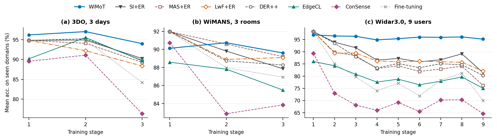
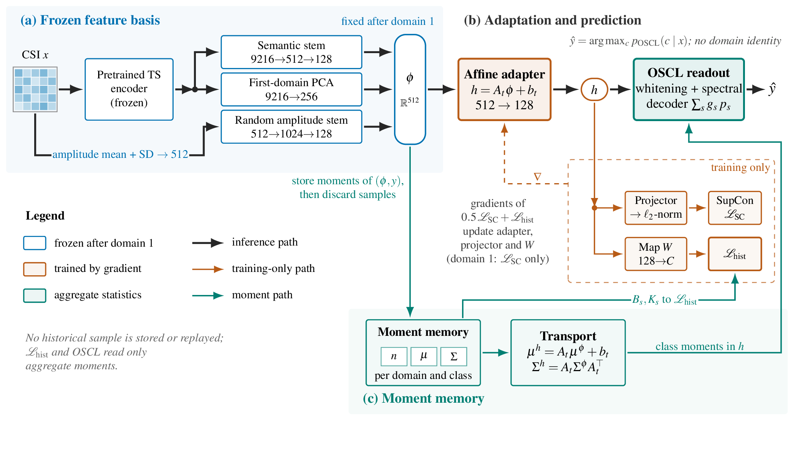
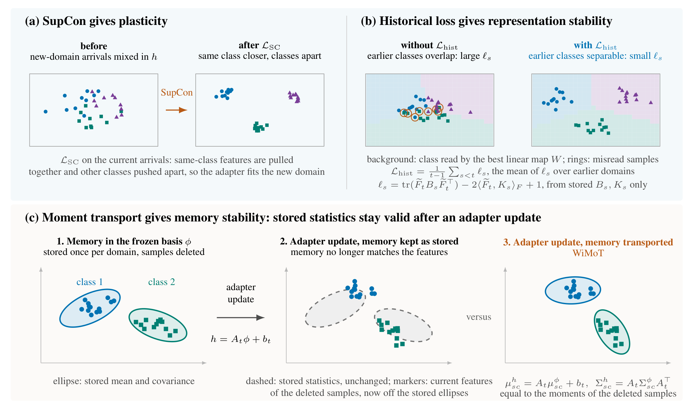
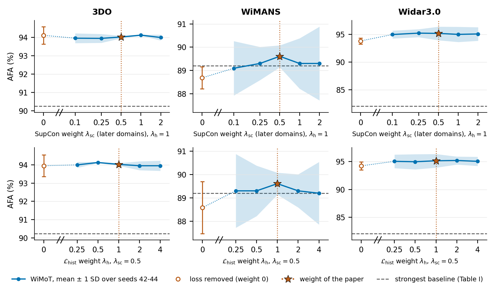

<div align="center">

# WiMoT: Replay-Free Continual Wi-Fi Sensing via Moment Transport

**Learn new rooms, days, and users from Wi-Fi CSI without keeping any earlier CSI.**

[](LICENSE)
[](requirements.txt)
[](requirements.txt)
[](#citation)

[Paper (TO BE ADDED)](#citation) · [Supplementary material (TO BE ADDED)](#citation) · [Citation](#citation) · [中文说明](README_zh.md)

</div>

<p align="center">
  
</p>
<p align="center"><sub><b>Accuracy over the stream</b> (paper Fig. 3). Mean test accuracy (%, vertical axis) over the domains seen so far after each
training stage (horizontal axis) in the original domain order, mean of three runs, for (a) 3DO (3 days), (b) WiMANS (3 rooms), and
(c) Widar3.0 (9 users). Curves: WiMoT, SI+ER, MAS+ER, LwF+ER, DER++, EdgeCL, ConSense, and fine-tuning (baselines with the 9728-dimensional input). Fine-tuning, SI+ER, MAS+ER, LwF+ER, and DER++ share
their first-domain network and therefore coincide at stage 1. The last point of each curve is the AFA of the table below
(WiMoT: 94.02, 89.61, and 95.16%).</sub></p>

Code for the article *WiMoT: Replay-Free Continual Wi-Fi Sensing via Moment Transport* (IEEE Internet of Things
Journal, [TO BE ADDED]). WiMoT is a replay-free continual learning algorithm: it learns new acquisition domains without storing any earlier sample.
In place of samples it stores, for each class of every earlier domain, the mean and covariance of its features in a frozen
feature basis. When the representation changes, such statistics become stale. WiMoT restricts the change to an affine adapter
and applies the same affine map to the stored statistics, so that they remain valid: an affine map sends a mean μ to Aμ + b and a covariance Σ to AΣAᵀ, as it does for the samples themselves. Supervised contrastive learning
with a historical loss computed in closed form from the stored statistics balances plasticity (learning a new domain) and
stability (keeping the earlier ones), and an OSCL classifier (a Gaussian discriminant classifier), refitted after every update
with equal weight per domain, predicts without a domain identifier.

<p align="center">
  
</p>
<p align="center"><sub><b>Framework.</b> (a) A frozen encoder and fixed stems form the basis φ. (b) An affine adapter maps φ to h; the OSCL
readout predicts from h without a domain identifier. (c) Class moments of φ are stored per domain and transported through the
current adapter.</sub></p>

<p align="center">
  
</p>
<p align="center"><sub><b>The three components</b> (paper Fig. 2), on synthetic two-dimensional points. (a) SupCon gives plasticity. (b) The historical loss gives representation stability: earlier classes remain linearly separable (rings: samples misread by the best linear map). (c) Moment transport gives memory stability: the stored statistics remain valid after an adapter update.</sub></p>

## Highlights

- **Plasticity and stability from one set of moments.** Supervised contrastive learning (SupCon) learns the new domain; a
  historical loss computed in closed form from the stored moments keeps earlier labels linearly readable; the OSCL classifier
  is refitted from the transported moments of all domains. WiMoT balances plasticity and stability: its forgetting
  is at most 0.58 pp on all three streams and its AFA is the highest on 3DO and Widar3.0 and on par on WiMANS, with a new-domain
  accuracy 0.67 to 3.49 pp below the best baseline.
- **A memory that does not expire.** After the first domain only an affine map is adapted, so the stored class means and
  covariances follow the representation through the same affine map; drift is not estimated.
- **No replay, no domain identifier.** No CSI window and no earlier feature is kept after an update. The memory of a
  domain is the count, mean, and covariance of each class in a 512-dimensional basis, whose size does not grow with the
  number of samples. The OSCL classifier infers domain weights from the input itself.
- **Frozen foundation model, light adapter.** MantisV2 features are fixed after extraction; the only components trained on
  later domains are a 512→128 affine adapter, a projector, and a linear map used inside the historical loss.
- **Ahead of 21 continual-learning baselines, including replay methods,** on 3DO (+3.77 pp)
  and Widar3.0 (+13.11 pp) in the main setting, and on par on WiMANS (+0.41 ± 0.64 pp of average final accuracy, with
  0.00 against 2.78 pp of forgetting). WiMoT forgets at most 0.58 pp on all three streams.

| Design question | Component | What it protects | Evidence from removal (paper, Table IV and Supplementary S9) |
|---|---|---|---|
| How to adapt without invalidating the memory? | Affine adapter on a frozen basis; moments moved by the same map | Validity of the stored memory | Frozen adapter: AFA −1.07 / −3.33 / −5.93 pp |
| How to learn the new domain without forgetting, with no samples? | SupCon (plasticity) and the historical loss (stability) | Learning of the new domain; the representation | Without SupCon: new-domain accuracy −5.60 to −6.85 pp. Without the historical loss: AFR +0.36 to +1.11 pp |
| How to predict without domain identity, consistent with the representation? | OSCL refitted on the transported moments of all domains, uniform priors | The classifier | Without the historical moments: AFA −17.04 / −5.31 / −47.10 pp |

## Results

Average final accuracy (AFA, %, higher is better) and average forgetting (AFR, percentage points, lower is better) after
the last domain; mean ± sample SD over seeds 42–44. All methods receive the 9728-dimensional input (the
frozen 9216-dimensional MantisV2 features and the 512-dimensional amplitude descriptor). The full table of 21 baselines is Table I of the paper; all values below are
computed from [`results/reference_results_same_input.json`](results/reference_results_same_input.json) by
[`scripts/readme_numbers.py`](scripts/readme_numbers.py).

| Method | Replay | 3DO AFA | 3DO AFR | WiMANS AFA | WiMANS AFR | Widar3.0 AFA | Widar3.0 AFR |
|---|:-:|:-:|:-:|:-:|:-:|:-:|:-:|
| **WiMoT (ours)** | no | **94.02 ± 0.07** | **0.32 ± 0.33** | **89.61 ± 0.47** | **0.00 ± 0.46** | **95.16 ± 1.23** | **0.58 ± 0.58** |
| Strongest baseline on each stream¹ | yes | 90.25 ± 0.67 | 5.64 ± 0.06 | 89.20 ± 1.07 | 2.78 ± 1.22 | 82.05 ± 1.07 | 10.25 ± 1.63 |
| SI+ER | yes | 90.25 ± 0.67 | 5.64 ± 0.06 | 87.86 ± 0.64 | 4.01 ± 0.27 | 81.38 ± 0.95 | 13.67 ± 0.75 |
| MAS+ER | yes | 89.28 ± 0.96 | 5.21 ± 0.40 | 89.20 ± 1.07 | 2.78 ± 1.22 | 76.17 ± 0.68 | 10.47 ± 0.88 |
| LwF+ER | yes | 88.36 ± 0.29 | −1.17 ± 0.41 | 89.09 ± 0.47 | 1.23 ± 0.27 | 82.05 ± 1.07 | 10.25 ± 1.63 |
| DER++ | yes | 89.81 ± 0.89 | 5.29 ± 0.51 | 88.27 ± 0.53 | 2.78 ± 1.22 | 80.25 ± 1.01 | 16.72 ± 1.39 |
| CN-DPM | yes | 88.48 ± 0.50 | 8.18 ± 0.32 | 86.32 ± 1.25 | 1.54 ± 2.09 | 74.84 ± 2.22 | 18.97 ± 2.63 |
| Fine-tuning | no | 84.19 ± 1.13 | 17.62 ± 1.70 | 86.93 ± 1.17 | 4.48 ± 0.96 | 70.02 ± 0.38 | 28.78 ± 0.34 |
| Joint training² | – | 90.64 ± 0.76 | – | 91.46 ± 0.94 | – | 94.84 ± 0.41 | – |

<sub>¹ SI+ER on 3DO, MAS+ER on WiMANS, LwF+ER on Widar3.0 (highest mean AFA among the 21 baselines; all three use replay). ² Non-continual reference: the baseline network trained on the union of all domains with the same 9728-dimensional
input (Supplementary Table S7); it is a reference, not an upper bound. Leads over the strongest baseline: +3.77, +0.41 ± 0.64, and +13.11 pp.
When the baselines receive only the 9216-dimensional Mantis block (Supplementary Table S12) the leads are +3.56, +1.03, and +13.28 pp;
against the better of the two input variants of each baseline they are +3.56, +0.41, and +13.11 pp. **WiMoT does not lead in every setting.** On WiMANS,
WiMoT has the highest six-order average AFA (+0.34 pp over SI+ER) and the lowest AFR in four of six orders and with 25% and 10% of the labels; the
AFA of WiMoT and of the strongest baseline are not separated in the main setting (+0.41 pp in two of three seeds); in three of six domain orders MAS or SI+ER is higher by 0.93–1.95 pp, with 25% or 10% of the
later-domain labels MAS is higher by 1.23 and 1.44 pp, and with five other foundation encoders (with the 9728-dimensional input of the respective encoder) the strongest of five baselines (SI+ER, or DER++ with TSPulse-r1) is higher by 2.67–5.04 pp.</sub>

**Plasticity and stability.** New-domain accuracy (mean accuracy on the domain learned in each update, a measure of
plasticity), accuracy on earlier domains after the last update, and AFR, computed from the stored accuracy matrices of the
same runs by [`scripts/plasticity_stability.py`](scripts/plasticity_stability.py) (paper: Table III).

| Method | 3DO new / earlier / AFR | WiMANS new / earlier / AFR | Widar3.0 new / earlier / AFR |
|---|:-:|:-:|:-:|
| **WiMoT (ours)** | 93.07 / **96.82** / 0.32 | 87.50 / **90.74** / **0.00** | 95.08 / **96.31** / **0.58** |
| Fine-tuning | 96.49 / 78.76 / 17.62 | 88.89 / 85.96 / 4.48 | 95.28 / 67.83 / 28.78 |
| SI+ER | 93.60 / 90.24 / 5.64 | 89.66 / 86.88 / 4.01 | 92.94 / 81.42 / 13.67 |
| MAS+ER | 91.71 / 90.24 / 5.21 | 90.12 / 88.43 / 2.78 | 83.31 / 76.72 / 10.47 |
| LwF+ER | 83.94 / 93.44 / −1.17 | 88.43 / 87.81 / 1.23 | 89.78 / 82.83 / 10.25 |
| DER++ | 92.39 / 90.39 / 5.29 | 89.20 / 87.50 / 2.78 | 94.72 / 79.19 / 16.72 |
| CN-DPM | 92.49 / 88.35 / 8.18 | 89.04 / 84.26 / 1.54 | 92.17 / 74.17 / 18.97 |

Fine-tuning learns the new domain well and forgets; baselines with low forgetting learn it less well (on 3DO, LwF+ER and
DUCT+ER have a lower AFR than WiMoT (−1.17 and −0.87 pp) but learn new domains 9.13 and 14.00 pp less accurately). The best baseline
learns the new domain 3.49 pp (3DO, A-GEM, AFR 14.64 pp), 2.62 pp (WiMANS, MAS+ER, AFR 2.78 pp), and 0.67 pp (Widar3.0, EWC+ER, AFR 19.25 pp)
better than WiMoT; WiMoT's forgetting stays at most 0.58 pp, so it balances learning the new domain and keeping the earlier ones.

Beyond the main setting (leads over the strongest baseline that was run in each setting, mean AFA, three seeds; paper Fig. 4 and
Tables VII–VIII, Supplementary Tables S1–S2; the baselines of all these settings receive the 9728-dimensional input, except those of the five-seed study, which receive the 9216-dimensional Mantis block):

- **Domain orders:** ahead in all six domain orders of 3DO (+1.13 to +6.81 pp) and in three further user orders of
  Widar3.0 (+9.58 to +14.52 pp); on WiMANS ahead in three of six orders (+0.41 to +1.85 pp) and behind in three (−0.93 to −1.95 pp).
  Widar3.0 rooms 2 and 3: +0.45 pp (SI+ER; ahead in two of three seeds, within seed variation) and +9.92 pp (DER++).
- **Encoders** (WiMoT against the strongest of five baselines: fine-tuning, LwF, SI+ER, DER++, EdgeCL): ahead with all seven encoders (pretrained MantisV2, a randomly initialized
  MantisV2, MOMENT-1-large, TSPulse-r1, Chronos-2, TimesFM 2.5, TimesFM 3.0) on 3DO (+3.77 to +9.56 pp) and Widar3.0 (+13.70 to +30.99 pp) in every seed; on WiMANS ahead
  with the two MantisV2 encoders (+1.03 and +1.44 pp) and behind with the five other models (−2.67 to −5.04 pp).
- **Few labels:** ahead with 25% or 10% of the labels in later domains on 3DO (+2.40 to +2.81 pp) and Widar3.0 (+9.85 to
  +10.57 pp); on WiMANS the lowest AFR (−0.46 and −0.62 pp) with an AFA of −1.23 and −1.44 pp relative to MAS.
- **Storage:** low-rank (rank 32) class moments need 6.4% of the memory of full covariances; the paired AFA change is
  between −0.49 and +1.07 pp (at most 0.49 pp lost). Storing upper triangles halves the memory with identical predictions.

## Additional analyses

Two analyses of the design (paper Table IV, Supplementary Sections S-VIII and S-IX); they change no coefficient of the main results.

**Readout ablation.** Each readout is fitted on the same adapters and stored moments of the full method (AFA, %, mean ± sample SD over seeds 42–46;
[`scripts/ablation_readout.py`](scripts/ablation_readout.py), results in [`results/additional_analyses/readout_ablation/`](results/additional_analyses/readout_ablation/)).

| Readout | 3DO | WiMANS | Widar3.0 |
|---|:-:|:-:|:-:|
| **OSCL (WiMoT)** | **93.98 ± 0.15** | **89.57 ± 0.55** | **95.24 ± 0.88** |
| Nearest class mean | 80.89 ± 0.89 | 87.84 ± 0.80 | 67.05 ± 1.28 |
| LDA | 92.06 ± 0.49 | 88.83 ± 1.33 | 84.43 ± 0.94 |
| QDA (no domain gate) | 91.00 ± 0.70 | 80.93 ± 1.33 | 91.41 ± 0.50 |
| Linear probe W | 85.77 ± 0.49 | 85.62 ± 1.10 | 81.94 ± 0.80 |

The paired difference between OSCL and LDA on WiMANS is +0.74 ± 1.39 pp (OSCL higher in three seeds, equal in one, lower in one), which does not
separate the two readouts; in all other pairs OSCL is higher in every seed.

**Loss-weight sweep.** AFA of WiMoT against the weight of the SupCon loss (λ<sub>sc</sub>, later domains) and the weight of the historical loss
(λ<sub>h</sub>), seeds 42–44 ([`scripts/ablation_loss_sweep.py`](scripts/ablation_loss_sweep.py), [`scripts/plot_loss_sweep.py`](scripts/plot_loss_sweep.py),
[`results/additional_analyses/loss_weight_sweep/`](results/additional_analyses/loss_weight_sweep/)).

<p align="center">
  
</p>

For every weight above zero (λ<sub>sc</sub> in 0.1–2, λ<sub>h</sub> in 0.25–4) AFA lies in 93.94–94.12% (3DO), 89.09–89.61% (WiMANS), and 94.96–95.21% (Widar3.0),
within about one seed SD of the setting of the paper (λ<sub>sc</sub> = 0.5, λ<sub>h</sub> = 1). Setting a weight to zero lowers AFA on WiMANS (−0.93 and −1.03 pp) and Widar3.0 (−1.36 and −0.91 pp) but not on 3DO
(+0.09 pp without SupCon in later domains, −0.08 pp without the historical loss, both within the seed SD); on 3DO the effect of removing
the historical loss is visible in AFR (0.43 against 0.32 pp), and removing SupCon in every domain lowers AFA by 2.17 pp. Because AdamW is
invariant to the scale of the loss, only the ratio λ<sub>sc</sub>/λ<sub>h</sub> matters: settings with equal ratio give identical accuracy matrices (maximum difference 0.00 pp).

## How it works

**The tension.** Continual learning without stored samples must satisfy two demands at once: fit the new domain
(plasticity) and keep recognizing the earlier ones (stability). Freezing the representation is stable but cannot learn;
unconstrained fine-tuning learns but forgets; updating the representation while keeping class statistics makes the
statistics describe an old representation, and estimating their drift is approximate. Forgetting arises on two levels: in the
*representation*, an update can discard directions that separate earlier classes, which no classifier can recover; in the
*classifier*, the stored memory or the decision rule can lag behind the representation or favor the newest domain.

**Three questions, three mechanisms.** WiMoT keeps one compact memory, the class counts, means, and covariances of every
domain in a frozen feature basis φ, and attaches one mechanism to each failure.

1. *How can the model adapt without invalidating its memory?* After the first domain only an affine adapter is trained, so
   the same affine map that changes the representation is applied to the stored class means and covariances, so the memory stays valid without drift estimation.
2. *How can it learn the new domain without forgetting, with no samples?* SupCon supplies plasticity. A historical loss
   computed from the stored moments supplies stability of the representation: it penalizes updates that make earlier labels
   less linearly readable (a proxy for readout accuracy, not a guarantee).
3. *How can it predict without a domain identifier, consistent with the representation?* The OSCL classifier is refitted after
   every update from the transported moments of all domains with uniform domain and class priors, which keeps the classifier
   consistent with the representation and does not favor the newest domain.

**Formulas.** In the first domain, a stem on the MantisV2 features, a first-domain PCA shortcut, and a fixed random stem on
the amplitude descriptor are trained with the supervised contrastive loss and frozen into a 512-dimensional basis φ. In
every later domain only the affine adapter (and the projector and the linear map W of the historical loss) are trained; the
arrivals are discarded after their moments are stored. The adapter maps the basis to the representation that the readout
uses:

$$h = A_t\,\phi + b_t$$

Moments stored in φ coordinates are transported into the current representation by the standard affine moment rule (also
applied, with estimated maps, in CASTER and DPCR). Here the map is the model's own adapter, so the stored moments follow the model that predicts, under a fixed basis and an affine adapter:

$$\mu^{h} = A_t\,\mu^{\phi} + b_t, \qquad \Sigma^{h} = A_t\,\Sigma^{\phi}A_t^{\top}$$

For the linear score map F = [W A_t, W b_t + d], centred over classes and scaled by its first-domain norm, each stored domain
s contributes the squared error of F against centred one-hot labels, in closed form from the stored second moment B_s and
label cross-moment K_s of [φ, 1]. The training loss is

```math
\mathcal L_t=\begin{cases}
  0.5\,\mathcal L_{\mathrm{SC}}, & t=1,\\
  0.5\,\mathcal L_{\mathrm{SC}}+\dfrac{1}{t-1}\displaystyle\sum_{s<t}\Big(\mathrm{tr}\big(\tilde F B_s \tilde F^{\top}\big)-2\langle \tilde F, K_s\rangle_F+1\Big), & t>1.
\end{cases}
```

The OSCL classifier (Yang, Tiomoko, and Wang, ICLR 2023) uses a Gaussian density model over h for domain weights g_s(x), so no
domain identifier is needed:

$$\hat y(x)=\arg\max_{c}\ \sum_{s\le t} g_s(x)\,p_s(c\mid x)$$

## Installation

```bash
git clone https://github.com/Newsteinwell/WiMoT.git && cd WiMoT
python -m venv .venv && source .venv/bin/activate
pip install torch==2.8.0                  # CUDA 12.8 build: add --index-url https://download.pytorch.org/whl/cu128
pip install -r requirements.txt           # torch, numpy, scipy, pytest
```

Feature extraction and data preparation need additional packages (`pip install -r requirements-features.txt` for MantisV2,
`pip install -r requirements-data.txt` for the raw-data readers). The numbers of the paper were produced with Python 3.12 on
Linux with a GPU; the code also runs on CPU and on macOS (Python 3.13, Apple silicon). Details: [docs/REPRODUCE.md](docs/REPRODUCE.md).

### Smoke test

```bash
python scripts/smoke_test.py            # about 3 minutes on a laptop CPU; --quick: about 1 minute
python -m pytest tests                  # about 15 seconds
```

The smoke test writes small synthetic feature files in the format of `wimot.features.extract`, then runs one full WiMoT
trajectory, a classic baseline, replay baselines, ConSense, EdgeCL, CN-DPM (shortened sleep phase), DUCT, DualCP+ER, the
joint-training reference, a subset of the `main` table through `wimot.study` and `scripts/build_tables.py`, and checks that
the Python interface below reproduces the command-line trajectory identically. It validates the code paths, not the accuracies.

## Quick start

WiMoT reads the frozen-encoder features of [`wimot.features.extract`](wimot/features/extract.py): 9728 coordinates per window
(9216 semantic coordinates pooled from the MantisV2 channel embeddings and a 512-dimensional amplitude descriptor), float32.
The first domain needs more than 256 windows, and every domain needs every class at least twice.

```python
import numpy as np
from wimot import WiMoT

# features/<domain>_<split>.npz hold `features` (N, 9728) and `labels` (N,), as written by wimot.features.extract
load = lambda domain, split: np.load(f"features/{domain}_{split}.npz")
domains = ["d1", "d2", "d3"]                        # acquisition domains in arrival order

model = WiMoT(num_classes=3, seed=42)               # device: CUDA if available, else CPU
for k, domain in enumerate(domains):
    train = load(domain, "train")
    model.fit_domain(train["features"], train["labels"])   # 1st call: trains the basis; later calls: incremental update
    seen = [load(d, "test") for d in domains[: k + 1]]
    print(domain, [round(model.score(t["features"], t["labels"]), 4) for t in seen])  # accuracy on all seen domains

labels = model.predict(load("d3", "test")["features"])     # no domain identifier needed
probabilities = model.predict_proba(load("d3", "test")["features"])
print(model.domains_seen, "domains,", model.storage_bytes, "bytes of stored class moments")
```

`WiMoT` wraps the same `Learner` that `python -m wimot.run` executes, so a trajectory driven through it gives the same
accuracy matrix, stage records, and stored statistics (`tests/test_api.py` checks bitwise equality on CPU). The command-line
entry points work on directories of such feature files:

```bash
python -m wimot.run train --root runs --features features --dataset 3do --seed 42 --family method --method main
python -m wimot.run test  --root runs --features features --dataset 3do --seed 42 --family method --method main
python -m wimot.run train ... --family classic --method si_er        # baselines: classic, wifi, recent, joint
```

## Reproducing the paper

The repository contains the data preparation from the official raw files, feature extraction, the job lists and locked
coefficients of every table, the per-seed reference results of every reported trajectory (`results/reference_results_same_input.json`, 1661 records, with the baselines on the 9728-dimensional input as in the paper tables; `results/reference_results.json`, 1652 records, with the baselines on the 9216-dimensional Mantis block), stage-wise test predictions,
and the coefficient-selection runs. Raw datasets, features, and model weights are not redistributed. Full instructions
(data, features, tables, time, determinism, reference results): **[docs/REPRODUCE.md](docs/REPRODUCE.md)**.

<details>
<summary>Tables and commands</summary>

```bash
FEATURES=/data/features RUNS=/data/runs SHARDS=4 experiments/run_table.sh <study>
python scripts/build_tables.py --runs /data/runs --study <study>       # comparison with the paper
python scripts/build_tables.py --reference-only --study <study>        # the paper numbers only
python scripts/check_predictions.py                                    # shipped predictions -> reference matrices
```

| Study | Paper | Trajectories |
|---|---|---|
| `main` | Table I; Fig. 3; Supplementary Tables S6, S8 | 198 |
| `ablation` | Table IV | 120 |
| `sameinput` | Table V; Supplementary Table S7 | 180 |
| `backbone` | Table VI; Supplementary Tables S3, S4 | 324 |
| `widarext` | Table VII; Fig. 4 | 90 |
| `orders` | Table VIII; Supplementary Table S1; Fig. 4 | 450 |
| `fewlabel` | Supplementary Table S2; Fig. 4 | 198 |
| `memory` | Table IX; Supplementary Table S5 | 45 |
| `extra_seeds` | Supplementary, additional seeds | 56 |

The job lists of the baselines with the 9728-dimensional input are in `configs/jobs_sameall/` (`python -m wimot.study sameall_<study>`, coefficients in `configs/locks_sameinput_all.json`); their records are in `results/same_input/` and are merged with the records of the method by `scripts/merge_same_input.py`. The trajectory counts above are those of the job lists with the 9216-dimensional Mantis block.

</details>

## Repository layout

```
wimot/            package: method/ (model, moments, historical loss, OSCL classifier), baselines/, features/, data/, run.py, study.py, api.py
configs/          streams, training protocol, locked coefficients, job lists (jobs/*.tsv), array digests
data/splits/      partition manifests of the three streams (440 KB)
results/          reference results (baselines with the 9216-D and 9728-D inputs), stage-wise test predictions (1337 trajectories), coefficient selection, additional analyses
scripts/          smoke_test.py, build_tables.py, check_predictions.py, readme_numbers.py, plasticity_stability.py, plot_stagewise.py, make_jobs.py,
                  make_jobs_same_input.py, same_input_report.py, merge_same_input.py, ablation_readout.py, ablation_loss_sweep.py, plot_loss_sweep.py, select_coefficients.py
experiments/      shell entry points for data, features, and one table
docs/             REPRODUCE.md
assets/           figures of this README
tests/            fast consistency checks (CPU)
```

## Citation

If you use this code, please cite the article (the entry is updated when the article is published; see also [CITATION.cff](CITATION.cff)):

```bibtex
@article{wimot,
  title   = {{WiMoT}: Replay-Free Continual {Wi-Fi} Sensing via Moment Transport},
  author  = {Yang, Chunchun and Cao, Yang and Chen, Zhitang},
  journal = {IEEE Internet of Things Journal},
  year    = {2026},
  note    = {Under review}
}
```

## License

MIT, see [LICENSE](LICENSE). `wimot/baselines/duct.py` and `wimot/baselines/cn_dpm.py` are adapted from MIT-licensed code
whose notices they retain; see [THIRD_PARTY_NOTICES.md](THIRD_PARTY_NOTICES.md) for these files, the dependencies, and the
model weights.

## Acknowledgments

We thank the providers of the datasets: 3DO (J. Strohmayer and M. Kampel, Zenodo
[10.5281/zenodo.10925351](https://doi.org/10.5281/zenodo.10925351)), WiMANS (S. Huang et al.,
[arXiv:2402.09430](https://arxiv.org/abs/2402.09430)), and Widar3.0 (Y. Zheng et al.,
[MobiSys 2019](https://doi.org/10.1145/3307334.3326081)); and the authors of MantisV2
([`paris-noah/MantisV2`](https://huggingface.co/paris-noah/MantisV2), package
[`mantis-tsfm`](https://github.com/vfeofanov/mantis)), whose frozen encoder provides the features. The DUCT and CN-DPM baselines
adapt the official code of [CVPR25-DUCT](https://github.com/Estrella-fugaz/CVPR25-DUCT) and
[CN-DPM](https://github.com/soochan-lee/CN-DPM). Please accept the terms of use of each dataset and model.
