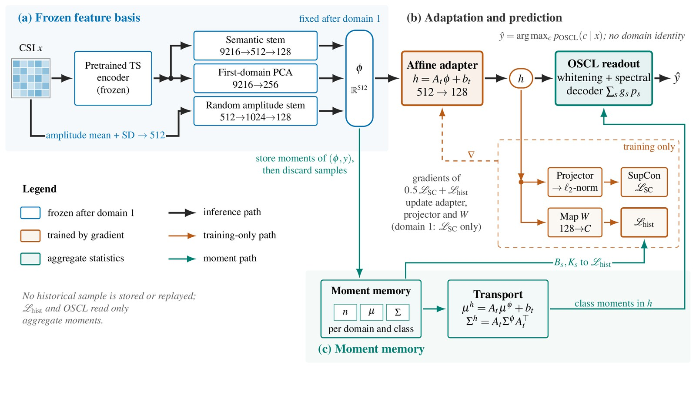
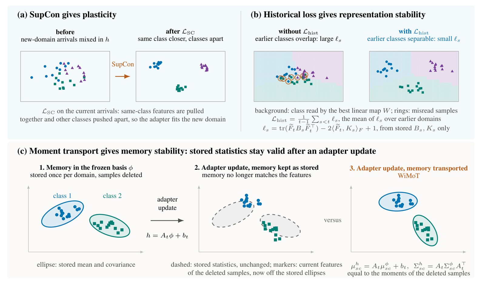
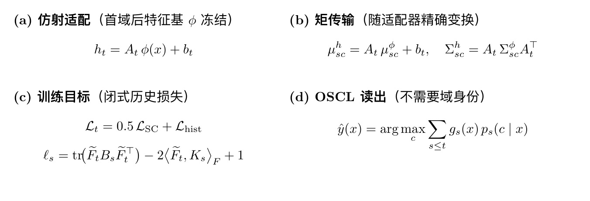
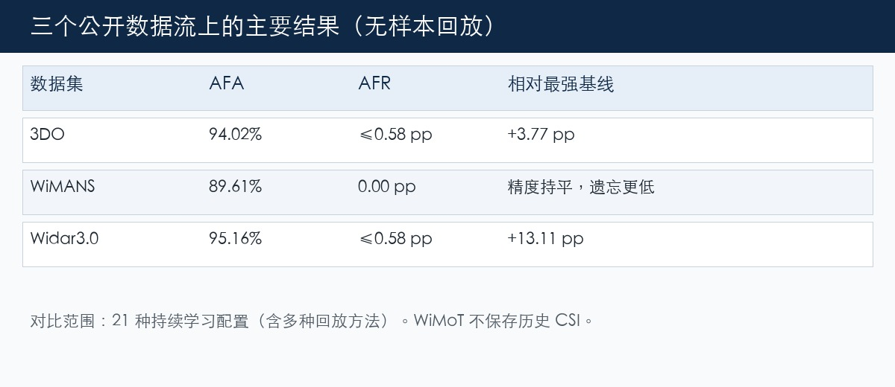
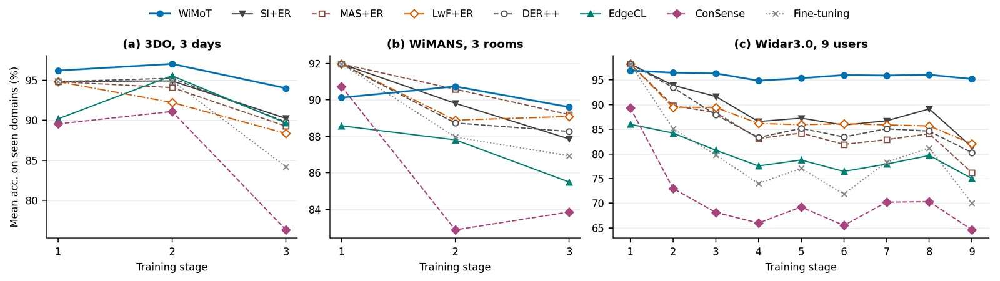
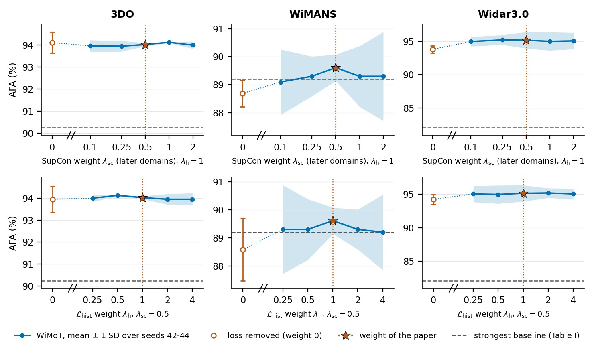

# 不存 CSI，也能持续学新房间：我们做的 WiMoT

Wi-Fi 感知能从信道状态信息（CSI）里识别人的活动，不必戴可穿戴设备。问题是：同样的动作，换个房间、换一天、换个人，CSI 往往就不一样了。落地的节点需要不断学习新条件，又不能把以前学会的忘掉。这就是持续学习里的**域增量**设定：活动类别固定，采集条件一个接一个到来。

很多做法会把以前的 CSI 样本存下来回放。这在家里或边缘设备上很难接受：涉及人的原始记录不宜长期保存，存储也不宽裕。我们关心的问题因此很具体：

**在不保存任何历史 CSI 的前提下，怎样学新域、又尽量不忘旧域？**

预印本和代码：

- 论文（含补充材料）：https://arxiv.org/abs/2610.32660
- 代码：https://github.com/Newsteinwell/WiMoT

---

## 核心想法：存「矩」，不存样本

WiMoT（Wi-Fi Moment Transport）不存 CSI，只为**每个已经见过的域、每个类别**保存特征空间里的一阶、二阶统计量：样本数、均值、协方差。分类器真正用到的，往往也就是这些量。

难点在于：如果后面还要调整特征表示，旧的均值和协方差会「对不上」新表示。一种常见做法是估计漂移再去校正；估计不准，记忆就会坏。

WiMoT 换了一条路：

1. **特征基底冻结。** 用冻结的时序基础模型（MantisV2）提特征，第一个域之后不再改这个基底。
2. **只训一个仿射适配器。** 后续域的表示变化，限制成 h = Aφ + b 这种仿射变换。
3. **同一个映射搬记忆。** 均值变成 Aμ + b，协方差变成 AΣAᵀ。适配器怎么变，存着的矩就怎么变，不必回放旧样本，也不必另估一套漂移。

整体流程如下图。

图 1 WiMoT 框架。(a) 冻结特征基底；(b) 仿射适配器与 OSCL 分类器；(c) 用同一仿射映射传输的类别矩记忆。

三个组件各自负责什么，可以用下图直观看一下：

图 2 三个组件（示意）。(a) SupCon 提供可塑性；(b) 历史损失提供表示稳定性；(c) 矩传输提供记忆稳定性。

关键公式关系可以概括成下面这组示意（适配 → 传输 → 损失 → 读出）：

图 3 仿射适配、矩传输、训练目标与 OSCL 读出的对应关系（示意）。

训练上大致两块：监督对比学习（SupCon）负责学好当前新域；由存储矩闭式算出的历史损失，约束旧类在当前表示里仍然可分。预测时用 OSCL 分类器，按各域等权、从传输后的矩重新拟合，**不需要域标签**。

一句话：**可塑性靠对比学习，稳定性靠历史损失，记忆靠「仿射 + 矩传输」对齐。**

---

## 实验上看到了什么

我们在三个公开 CSI 数据流上评测：3DO、WiMANS、Widar3.0，并和 21 种持续学习配置对比（含多种回放方法）。主要数字可以先看这张汇总卡：

图 4 三个数据流上的 AFA / AFR，以及相对最强基线的差距概览。

更细一点写：

- 3DO：AFA 94.02%
- WiMANS：AFA 89.61%
- Widar3.0：AFA 95.16%

遗忘（AFR）都不超过 0.58 个百分点。相对最强基线，3DO、Widar3.0 上分别大约领先 3.77 和 13.11 个百分点（对方用回放，WiMoT 不存样本）；WiMANS 上精度与最强回放方法大致持平，遗忘从约 2.78 降到 0.00。论文里也写了 WiMANS 上优势不明显的原因，以及不太适合的场景（短数据流、每类样本相对特征维数偏少、编码器偏弱等）。

逐阶段的精度曲线如下。WiMoT 在各阶段之后对已见域的平均测试精度整体更稳：

图 5 三个数据流上，每个训练阶段之后在已见域上的平均测试精度。WiMoT 曲线末点对应上表 AFA。

历史损失权重怎么选，也会影响最终精度。下图是损失权重扫描：

图 6 历史损失权重对平均最终精度的影响。合适的权重能在学新与保旧之间取得更稳的折中。

存储上，完整协方差占大头；用秩-32 因子近似后，矩的存储可降到大约 6.4%，精度损失不超过约 0.49 个百分点。

---

## 小结

WiMoT 想回答的是边缘 Wi-Fi 感知里很现实的约束：**不能（或不愿）长期保存 CSI，又要持续适应新环境。** 做法是把记忆建成类别矩，把表示更新收成仿射，再用同一仿射搬矩。细节、消融和补充实验见 arXiv；复现脚本在 GitHub。

论文目前以预印本形式公开在 arXiv 上，欢迎讨论和指正。

- 论文：https://arxiv.org/abs/2610.32660
- 代码：https://github.com/Newsteinwell/WiMoT
